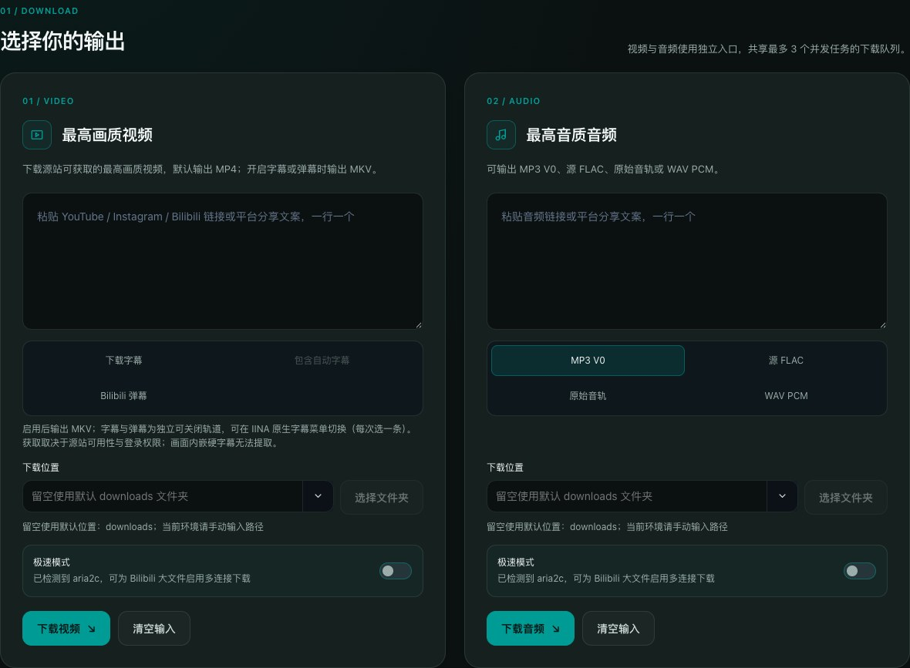
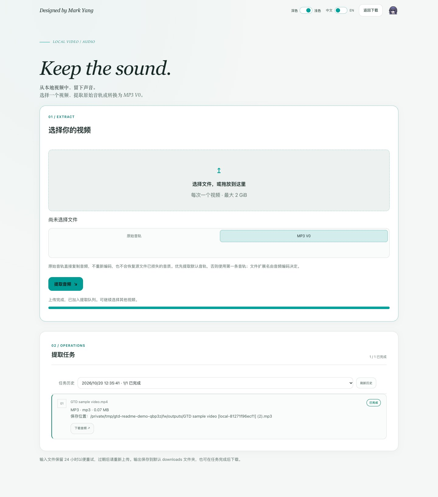

<p align="center">
  
</p>

<h1 align="center">GTD</h1>

<p align="center"><strong>Generalized Transmedia Downloader</strong><br>多平台媒体批量下载与本地音频提取。</p>

<p align="center"><strong>简体中文</strong> · <a href="README.md">English</a></p>

<p align="center">
  
  
  
</p>

GTD 基于 [yt-dlp](https://github.com/yt-dlp/yt-dlp)、Flask 和 FFmpeg，为 YouTube、Instagram 与 Bilibili 提供统一的批量下载流程。通过浏览器管理任务，或从命令行直接下载；本地视频也可独立提取音轨。

**运行方式：源码启动 Web / CLI，适用于 macOS 与 Windows。** 安装 Python 依赖和媒体工具后即可使用。

[快速开始](#快速开始) · [命令行](#命令行使用) · [完整使用参考](docs/REFERENCE.md) · [网页使用指南](docs/WEB_GUIDE.md) · [问题反馈](https://github.com/MarkYang44/GTD/issues)

## 界面与实际使用

**下载工作区 · 深色主题**

视频和音频独立输入，可选择输出格式、字幕及自定义下载目录。



<details>
<summary><strong>本地视频 → MP3 · 浅色主题</strong></summary>

上传视频，选择 MP3 V0，完成后直接从任务列表下载音频。



</details>

截图来自当前网页界面的独立本地会话。提取示例使用生成的测试视频，并实际执行 FFmpeg 转换；不包含个人媒体或账号数据。

## 功能概览

| 模块 | 能力 |
| --- | --- |
| 多平台下载 | 混合提交 YouTube、Instagram、Bilibili 链接或分享文案，自动识别平台；支持播放列表、合集和分 P 预览与选择 |
| 视频与音频 | 下载最高可用质量的视频与音轨；视频默认输出 MP4，音频可选 MP3 V0、源 FLAC、原始音频或 WAV PCM；支持封面写入与缺失封面兜底 |
| 字幕与弹幕 | 可选下载人工字幕、自动字幕及 Bilibili 弹幕，封装为可切换的 MKV 轨道 |
| 任务管理 | 显示进度、速度、预计剩余时间与结构化错误；支持取消、重试、重新下载和持久化历史 |
| 本地音频提取 | 上传或拖放本地视频，提取原始音轨或转换为 MP3 V0，并下载处理结果 |
| 界面与输出 | 中英文、深浅主题跨页面保存；支持自定义输出路径和 macOS / Windows 原生文件夹选择器 |

所有 Web 批次共用最多 **3 个工作槽**，本地音频提取也使用该队列；Bilibili 最多同时下载 **2 项**，Instagram 最多 **1 项**。CLI 每批采用相同并发上限。每批最多选择 100 项，合集预览最多列出前 1000 项并提示截断。

## 快速开始

### 1. 准备环境

| 依赖 | 用途 |
| --- | --- |
| Python 3.10+ 与 pip | 运行 Web 服务和命令行工具 |
| FFmpeg 与 ffprobe | 音视频合并、媒体检查、音频转换与提取 |
| aria2c（可选） | Bilibili 极速模式；未安装时仍可使用标准下载 |
| Node.js 22（开发检查） | 运行 JavaScript 回归脚本 |

macOS 可通过已安装的 Homebrew 准备媒体工具：

```bash
brew install ffmpeg
# 可选
brew install aria2
```

Windows 请从 [Python 官网](https://www.python.org/downloads/windows/) 安装 Python，并按 [FFmpeg 下载页](https://ffmpeg.org/download.html) 的 Windows 链接安装包含 `ffmpeg.exe` 和 `ffprobe.exe` 的发行版，将其 `bin` 目录加入 `PATH`。安装后重新打开终端，确认以下命令可用：

```bash
ffmpeg -version
ffprobe -version
```

### 2. 获取源码并安装依赖

```bash
git clone https://github.com/MarkYang44/GTD.git
cd GTD
```

macOS：

```bash
python3 -m venv venv
source venv/bin/activate
python -m pip install -r requirements.txt
```

Windows PowerShell：

```powershell
py -3 -m venv venv
.\venv\Scripts\python.exe -m pip install -r requirements.txt
```

Windows 无须修改 PowerShell 执行策略或激活虚拟环境。下文命令中的 `python`，在未激活环境时替换为 `.\venv\Scripts\python.exe`；macOS 对应 `venv/bin/python`。

直接依赖以 [requirements.txt](requirements.txt) 为准，间接依赖由 pip 按系统与 Python 版本解析。请安装完整依赖文件，以包含封面处理等依赖。

### 3. 启动网页

```bash
python app.py
```

打开 **[http://127.0.0.1:8233](http://127.0.0.1:8233)**，在视频或音频区逐行粘贴链接。合集会先显示选择面板，提交后即可查看进度。默认输出到项目内 `downloads/`，也可在网页中选择其他目录。终端按 `Ctrl+C` 停止服务。

> 服务默认监听 `0.0.0.0:8233`，没有登录验证。同一局域网内能够连接该端口的设备可提交任务并访问结果；仅在可信网络使用，不要将端口映射到公网。远程访问时，文件夹选择器操作的是运行服务的电脑。

## 命令行使用

运行交互模式，按提示选择视频 / 音频、输出目录和待下载链接：

```bash
python main.py
```

也可以直接传入参数；以下示例中的链接需替换为实际目标：

```bash
# 下载视频；可在同一条命令后追加多个链接
python main.py "https://www.youtube.com/watch?v=VIDEO_ID"

# 选择音频输出：mp3 / flac / source / wav
python main.py --audio --audio-format mp3 "https://www.youtube.com/watch?v=VIDEO_ID"

# 播放列表或多分 P 必须明确选择条目
python main.py --items 1-5 "https://www.youtube.com/playlist?list=PLAYLIST_ID"

# 视频字幕、自动字幕与 Bilibili 弹幕
python main.py --subtitles --auto-subtitles --danmaku "https://www.bilibili.com/video/BV_ID"

# Bilibili 可选极速模式，需要 aria2c
python main.py --turbo "https://www.bilibili.com/video/BV_ID"
```

使用 `--output-dir "路径"` 指定目录，`--download-dir` 为等价别名。相对路径以项目根目录为基准，缺失目录会尝试创建；含空格的路径和所有 URL 均应加引号。合集可用 `--items all`，但仍受每批 100 项上限约束。参数模式会直接开始下载。

CLI 全部成功返回 `0`，存在失败或无有效链接返回 `1`，交互输入被用户中断返回 `130`。

## 输出与可用性

- **视频**：默认 MP4；开启字幕或弹幕后使用 MKV，字幕与 ASS 弹幕作为独立轨道。仅获取源站实际提供且当前账号可访问的内容；无法提取烧录在画面中的字幕。
- **音频**：MP3 使用 V0；`source` 保留选中源音轨的编码；`wav` 解码为 PCM。`flac` 仅在源站实际提供 FLAC 时使用，否则回退 MP3 V0；转码不会提升有损源的音质。
- **本地提取**：支持原始音轨和 MP3 V0，单文件上传上限 2 GiB。支持的容器、暂存配额与清理规则见[网页指南](docs/WEB_GUIDE.md#从本地视频提取音频)。
- **文件保留**：重复下载采用 `(2)`、`(3)` 等后缀保留旧文件。服务重启后，未完成任务标记为 `INTERRUPTED`，需要手动重试。
- **平台限制**：内容可用性取决于源站、账号权限及 yt-dlp 支持情况。Bilibili 可自适应选择源站提供的备用 CDN；极速模式失败时可降级为标准模式，实际速度仍取决于网络与 CDN。

## 数据与隐私

| 位置 | 内容 |
| --- | --- |
| `downloads/` 或自选目录 | 下载媒体与音频提取结果 |
| `state/tasks.sqlite3` | 任务历史、源链接、输出路径与结果；可用 `GTD_HISTORY_PATH` 指定其他位置 |
| `state/audio_uploads/` | 本地提取使用的视频暂存副本 |
| `logs/downloader.jsonl` | 脱敏事件日志，按 10 MiB 轮转，最多保留 5 个备份 |
| 浏览器本地存储 | 语言、主题、最近输出目录 |

需要登录的内容，可在项目根目录放置 Netscape 格式的 `youtube_cookies.txt`、`instagram_cookies.txt` 或 `bilibili_cookies.txt`；平台专用文件优先于通用 `cookies.txt`。导出步骤见[Cookie 配置](docs/WEB_GUIDE.md#登录内容与-cookie)。更换 Cookie 后重启服务。

Cookie 等同于登录凭证；不要上传或提交。任务历史和媒体也可能包含个人信息。提交 Issue 时只提供必要的脱敏日志片段。

GTD 下载、合集预览、字幕 / 弹幕与极速模式使用**直连**。仅在自身进程内清除代理环境变量并设置 `NO_PROXY=*`，不修改系统、VPN 或终端配置；仍需当前网络能够访问源站。

## 常见问题

| 问题 | 建议 |
| --- | --- |
| 网页无法访问 | 确认 `python app.py` 持续运行，检查终端错误和 8233 端口占用 |
| 未检测到 FFmpeg / ffprobe | 确认两者位于 `PATH`，重开终端后重新启动 GTD |
| 要求登录或 `HTTP 403` | 确认浏览器账号有权播放，再更新对应平台 Cookie |
| `HTTP 429` / Bilibili `HTTP 412` | 降低请求频率并稍后重试；不要连续反复提交 |
| CDN 断连 / `NETWORK_CONNECTION_RESET` | 自动备用线路仍失败时，检查直连网络并稍后手动重试 |
| 提取提示 `NO_AUDIO` / `INPUT_EXPIRED` | 确认视频包含音轨；暂存已过期时重新上传 |
| 上游页面变化导致解析失败 | 按下方说明选择更新通道，重启后再试 |

可选的上游更新通道会安装持续变化的 yt-dlp 主分支；使用前应了解其可能与固定基线行为不同：

```bash
python -m pip install --upgrade --force-reinstall --no-cache-dir -r requirements-update.txt
# 恢复固定直接依赖基线
python -m pip install --force-reinstall -r requirements.txt
```

## 开发与验证

项目采用 Python + Flask / Jinja 与原生 HTML / CSS / JavaScript，无需前端构建步骤。Web 与 CLI 共用下载核心。

模块边界、应用工厂生命周期与兼容性约定见[架构与安全重构指南](docs/ARCHITECTURE.zh-CN.md)。

| 入口 / 目录 | 职责 |
| --- | --- |
| `app.py` / `main.py` | Web / CLI 入口 |
| `downloader.py` / `task_control.py` | 下载核心与任务调度 |
| `download_requests.py` / `web_runtime.py` | 请求校验与应用独立的资源生命周期 |
| `download_options.py` / `bilibili_recovery.py` | 下载配置与 CDN 恢复策略 |
| `local_audio.py` / `audio_extract_routes.py` | 本地媒体提取与接口 |
| `templates/` / `static/` | 网页模板、样式、脚本与资源 |
| `tests/` / `.github/workflows/tests.yml` | Python、JavaScript 与浏览器回归 |

在项目根目录运行；JavaScript 回归需 Node.js 22，真实音频测试需 FFmpeg / ffprobe：

```bash
python -m unittest discover -s tests -p "test_*.py"

# 可选：完整浏览器回归
python -m pip install -r requirements-dev.txt
python -m playwright install chromium
python -m unittest discover -s tests/browser -p "test_*.py"
```

CI 配置覆盖 macOS / Windows、Python 3.10 / 3.13。平台下载测试使用模拟响应，不代表实时源站连通性或下载速度；部分媒体测试在缺少 FFmpeg / ffprobe 时跳过。浏览器测试使用独立测试服务和临时状态目录。

## 使用边界与致谢

仅下载你拥有、获授权使用或平台允许下载的内容，遵守源站条款与适用法规。GTD 不绕过 DRM、登录权限或会员限制。

感谢 [yt-dlp](https://github.com/yt-dlp/yt-dlp)、[Flask](https://github.com/pallets/flask)、[FFmpeg](https://ffmpeg.org/)、[Mutagen](https://github.com/quodlibet/mutagen) 与 [aria2](https://github.com/aria2/aria2)。

<p align="center">Designed by Mark Yang</p>
